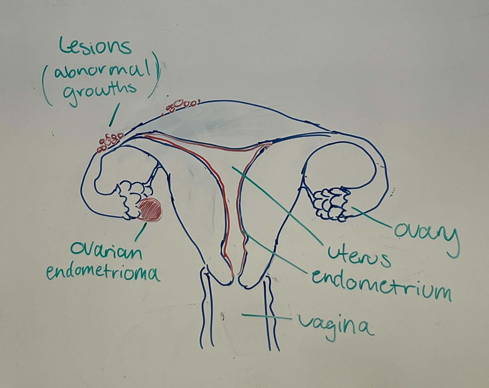
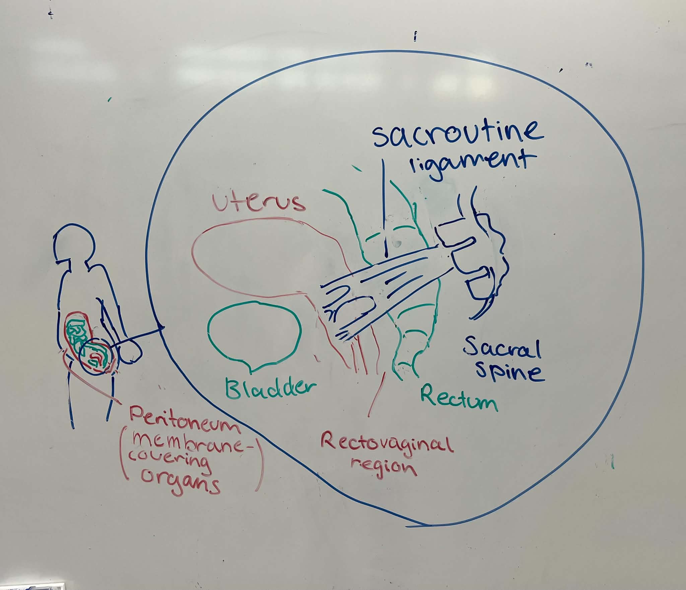

## Introduction

::::: columns
::: {.column width="50%"}
**Background**:

-   Endometriosis is a chronic, inflammatory, estrogen-driven disease
-   Lesions (endometrium-like tissue) grow outside of the uterus.
-   The cause of endometriosis is unknown

**Aim**:

-   We aimed to identify differences in gene expression profiles for endometrium, peritoneum and lesion tissue for endometriosis patients and compare them to healthy tissue gene profiles.
:::

::: {.column width="50%"}
{style="max-height: 45vh; width: auto;"} {style="max-height: 55vh; width: auto;"}
:::
:::::

## Materials and Methods

EndometDB: Database of log2-transformed mRNA expression of \~20,000 genes and \~28,000 probes across 330 patient samples and 62 control samples.

-   **From probes to samples:** Average expression of probes mapping to the same gene and tissue
-   **Tidying & augmenting:** Reshaped to samples as rows, genes as variables; added clinical/tissue labels (patient/control, tissue type, lesion type)
-   **Analysis pipeline:**
    -   1: Computed control-relative expression and found the genes most different from controls
    -   2: Found out if the difference was significant
    -   3: Looked at the spread

## Describe

Number of sample in each tissue type (col)

mean gene expression across different samples boxplot

Standard deviation of gene expression within different tissue type (col)

## Analysis 1 - Plotting - 1/2

**Relative expression = sample expression − mean of the controls**

-   Patients vs. controls (CE vs PE and CP vs PP)
-   Lesions vs. control endometrium
-   Top 10 genes for each comparison
-   Plots
    -   Histogram
    -   Barcharts
    -   Boxplots, shown in grid plots with `facet_wrap()`, one panel per gene

## Analysis 1 - Plotting - 2/2

## Analysis 2 - Statistical analysis

## Analysis 3

## Results and discussion - 1/2

## Results and discussion - 2/2

```{=html}
<style>
.reveal .slides { font-size: 28px; }
</style>
```
