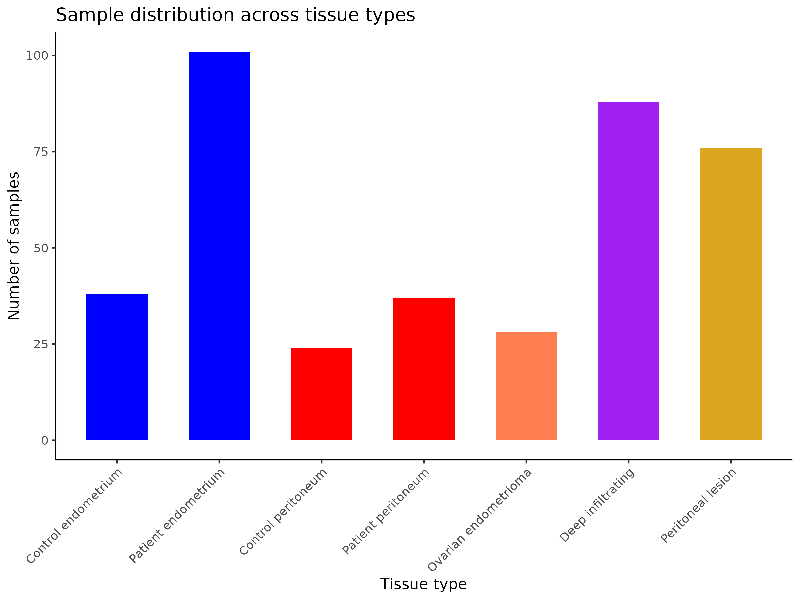

## Introduction

**Background**:

-   Endometriosis is a chronic, inflammatory, estrogen-driven disease where lesions (endometrium-like tissue) grow outside of the uterus.
-   The cause of endometriosis is unknown - that's why we choose to investigate the gene expression profiles of disease tissue and compare it to healthy tissue.

**Aim**:

-   In our project we aimed to identify differences in gene expression profiles for endometrium, peritoneum and lesion tissue for endometriosis patients and compare them to healthy tissue gene profiles.

{width="411"}

## {width="345"}

## Materials and Methods

**Data:**

-   EndometDB: Database of log2 transformed mRNA expression of xx amount of genes and xx many samples of tissue and different lesion types in endometriosis patients, as well as xx samples of healthy control tissue.

    {width="434"}

**Workflow**

-   Loaded xlsx file and transformed it to tsv file
-   --\> Clean --\> Augment --\> Describe --\> Analyse

## Describe

Number of sample in each tissue type (col)

mean gene expression across different samples boxplot

Standard deviation of gene expression within different tissue type (col)

## Analysis 1 - Plotting - 1/2

**Relative expression = sample expression − mean of the controls**

-   Patients vs. controls (CE vs PE and CP vs PP)
-   Lesions vs. control endometrium
-   Top 10 genes for each comparison
-   Plots
    -   Histogram
    -   Barcharts
    -   Boxplots, shown in grid plots with `facet_wrap()`, one panel per gene

## Analysis 1 - Plotting - 2/2

## Analysis 2 - Statistical analysis

## Analysis 3

## Results and discussion - 1/2

## Results and discussion - 2/2

```{=html}
<style>
.reveal .slides { font-size: 28px; }
</style>
```
